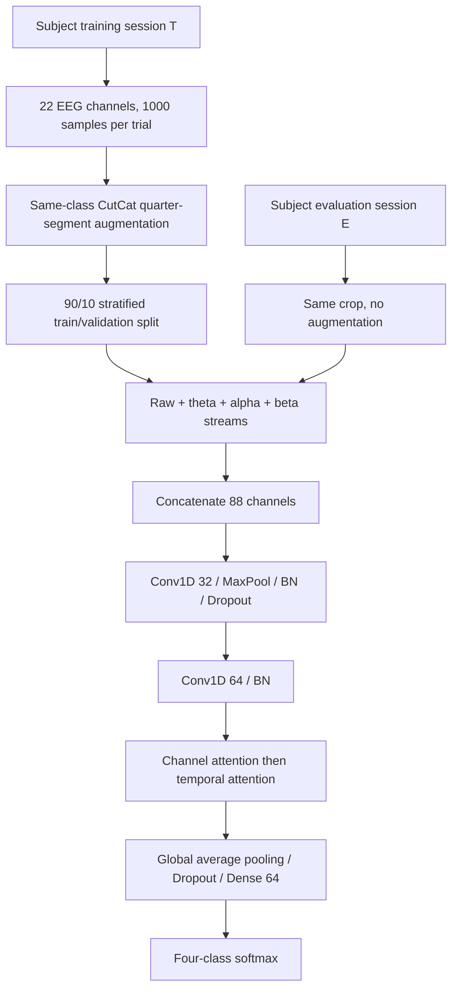

# MB-ATNet: Multiband Attention Network for Motor Imagery EEG Classification

**Four-class motor imagery EEG classification with multiband inputs and attention.**

**Authors:** Uddeshay Anand, Kusum Kumari Bharti and Mohd Sameer.
Presented as a technical paper at the **Mind, Brain and Consciousness Conference
2026**, IIT Mandi, June 3–6, 2026. See the [paper](docs/paper.pdf) and
[certificate of authorship](docs/conference-certificate.pdf).

[Research notebook](notebooks/multiband_cbam_s1.ipynb) · [Paper](docs/paper.pdf) · [Conference certificate](docs/conference-certificate.pdf) · [Pipeline](#pipeline) · [Research evidence](#research-evidence-and-source-traceability)

The four classes are imagined left-hand, right-hand, foot, and tongue movements.
The implementation combines raw EEG with theta, alpha, and beta streams and
processes each subject independently.

## Repository structure

```text
get_data.py       Read training/evaluation MATLAB sessions
preprocessing.py CutCat augmentation, validation split and frequency filtering
model.py         Four-input Conv1D model with 1-D CBAM attention
train.py         Train independent subject models and save outputs
test.py          Evaluate final or best saved weights on Session E
evaluate.py      Metrics, confusion matrices, learning curves and t-SNE
requirements.txt Pinned direct dependencies
notebooks/       Research notebook for Subject 1, with existing output preserved
docs/            Research paper and conference certificate
```

## Setup

Use Python 3.11 or 3.12. From a local checkout of this repository:

```bash
python -m venv .venv
# Linux/macOS:
source .venv/bin/activate
# Windows PowerShell (instead of the preceding line):
.venv\Scripts\Activate.ps1
python -m pip install -r requirements.txt
```

The direct dependencies pin the recorded environment. For GPU setup,
follow [TensorFlow's platform instructions](https://www.tensorflow.org/install/pip);
modern TensorFlow GPU execution on Windows requires WSL2. Full training with the
default augmentation creates 7,488 trials per subject and multiple filtered copies;
allow several GB of available RAM and use a GPU for long runs.

## Dataset

Download the **Four class motor imagery (001-2014)** MATLAB files from the
[BNCI dataset page](https://bnci-horizon-2020.eu/database/data-sets).
Use `A01T.mat`–`A09T.mat` and `A01E.mat`–`A09E.mat`, containing the labeled `data`
run structures.

Both layouts are supported:

```text
dataset/                       dataset/
  A01T.mat                       Training/A01T.mat
  A01E.mat                       Evaluation/A01E.mat
  ...                            ...
  A09T.mat                       Training/A09T.mat
  A09E.mat                       Evaluation/A09E.mat
```

An external dataset directory is also accepted through `--data-path`.

## Train

One subject with the notebook defaults:

```bash
python train.py --data-path dataset --subjects 1 --output-dir results
```

All nine subjects, each with its own model, training split and output directory:

```bash
python train.py --data-path dataset --subjects 1 2 3 4 5 6 7 8 9 --output-dir results_all
```

Omitting `--subjects` also selects all nine. This is **within-subject, cross-session
evaluation**: train on each subject's T session and test on that subject's E session.

A short execution check (not a research result):

```bash
python train.py --data-path dataset --subjects 1 --epochs 1 --expansion-factor 0 --output-dir results_smoke
```

The default expansion factor is 25 synthetic trials per original trial, batch size
64, maximum epochs 1,000, Adam learning rate `1e-4`, stratified validation fraction
0.1, and seed 42. Training stops if validation loss reaches 0.025. `--epochs`,
`--batch-size`, `--expansion-factor`, and `--seed` expose these existing training
controls. Factor 0 is a small usability extension that disables augmentation. Use `--no-tsne`
only when you explicitly want to skip the slower t-SNE plots.

## Test saved weights

```bash
python test.py --data-path dataset --run-dir results/subject_01
python test.py --data-path dataset --run-dir results/subject_01 --checkpoint best
```

The default uses **final** weights, matching evaluation of the final in-memory model
in the notebook. `best` explicitly selects minimum-validation-loss weights and is a
different checkpoint policy. The model is rebuilt from `model.py` before loading
weights, avoiding full-model Lambda deserialization.

## Pipeline



The loader retains all trials, including artifact-flagged trials, and crops the
notebook's 2–6 s interval from a seven-second window at 250 Hz. Class order is
left hand, right hand, foot, tongue. CutCat interleaves quarters of two same-class
trials with pattern A/B/A/B. The filtering function removes the temporal mean and
uses fourth-order Butterworth filters with `filtfilt`; theta (4–8 Hz), alpha
(8–13 Hz), and beta (13–30 Hz) feed the network alongside the unchanged raw stream.
The original function also computes delta and gamma, but the model does not use them.

CBAM uses shared channel-attention Dense layers with reduction ratio 8 followed by
temporal attention with a seven-sample convolution. The classifier uses dropout
0.4/0.3 and Dense L2 regularization 0.002. The [supplied notebook](notebooks/multiband_cbam_s1.ipynb)
and [model source](model.py) are the available implementation references.

## Outputs

Each `subject_XX/` contains:

- `run.json`: configuration, dependency versions, duration and completed epochs.
- `best.weights.h5` and `final.weights.h5`: separate checkpoint policies.
- `training_history.npz` and `learning_curves.png`.
- `Train`, `Val`, and `Test` metrics JSON files: accuracy, weighted precision,
  weighted recall, weighted F1 and Cohen's kappa.
- Predictions NPZ files: true labels, predicted labels, probabilities and confusion
  matrix; count and row-percentage confusion-matrix PNGs.
- t-SNE plots of **four-dimensional softmax probabilities**, as in the
  notebook; these are not embeddings of the penultimate hidden layer.

### Complete notebook plot mapping

All plotting code lives in [`evaluate.py`](evaluate.py). `train.py` calls it
automatically for each subject, producing these **10 PNG files**:

| Notebook plot | Function | Output files |
| --- | --- | --- |
| Confusion matrices (counts), train/validation/test | `plot_cm_counts` | `Train_cm_counts.png`, `Val_cm_counts.png`, `Test_cm_counts.png` |
| Confusion matrices (row percentages), train/validation/test | `plot_cm_percent` | `Train_cm_percent.png`, `Val_cm_percent.png`, `Test_cm_percent.png` |
| Training and validation accuracy/loss, two panels | `plot_learning_curves` | `learning_curves.png` |
| t-SNE, train/validation/test | `plot_tsne` | `tsne_train.png`, `tsne_val.png`, `tsne_test.png` |

`test.py` generates the two test confusion matrices and test t-SNE automatically.
Figures retain the notebook's sizes, color maps, labels and 150-DPI saving.
The notebook's `plt.show()` calls are replaced with file saving and figure closing
for headless command-line execution; open the generated PNGs to view them.
No extra plotting module or new analysis plots are required.

`summary.csv` records test metrics for subjects completed in that invocation.
Standalone testing writes to `evaluation_final/` or `evaluation_best/` below the
subject directory. Repeating that test command replaces that checkpoint's evaluation
outputs. Generated results, datasets and virtual environments are ignored by Git.

## Research context and reproducibility

The supplied paper reports **77.17% mean accuracy** and **0.696 mean Cohen's kappa**
across nine subjects (its Table 3 instead rounds the mean kappa to 0.695).

The notebook augments **before** the validation split, so train and validation
examples can contain segments from the same original trial. Validation performance
is therefore not an independent-trial estimate. Session E remains separate and
unaugmented. This protocol is deliberately preserved, not silently repaired.
The notebook's direct MATLAB trial-index slicing and raw-stream handling are also
preserved. Refer to the
[paper](docs/paper.pdf) and [notebook](notebooks/multiband_cbam_s1.ipynb) as separate
research and implementation sources.

## Research evidence

| Material or claim | Available reference | Scope |
|---|---|---|
| Reported 77.17% mean accuracy and mean Cohen's kappa | [Research paper](docs/paper.pdf) | Paper-reported findings, not newly generated repository results |
| Conference presentation and authorship | [Conference certificate](docs/conference-certificate.pdf) | Supporting conference document |
| Notebook implementation | [multiband_cbam_s1.ipynb](notebooks/multiband_cbam_s1.ipynb) | Supplied research notebook with existing output retained |
| Data loading and preprocessing | [get_data.py](get_data.py) and [preprocessing.py](preprocessing.py) | MATLAB session loading, augmentation, splitting, and filtering source |
| Model and training | [model.py](model.py) and [train.py](train.py) | Model construction and subject-specific training source |
| Evaluation and visualization | [test.py](test.py) and [evaluate.py](evaluate.py) | Saved-weight evaluation, metrics, and plotting source |

